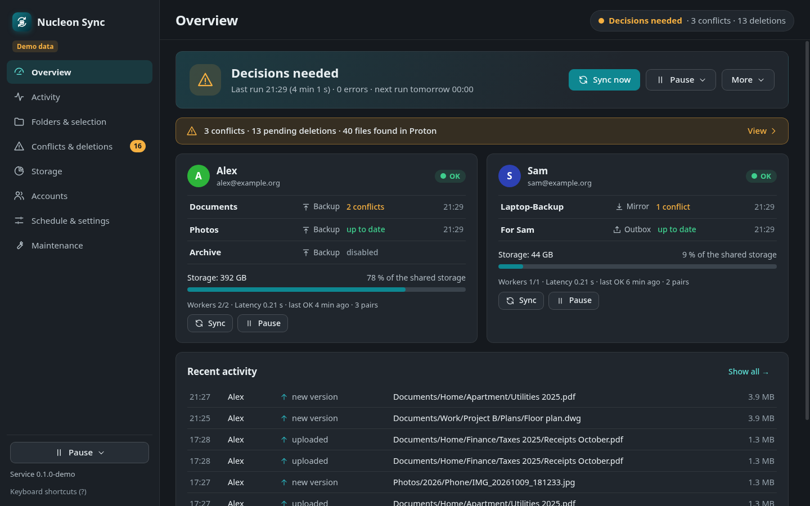
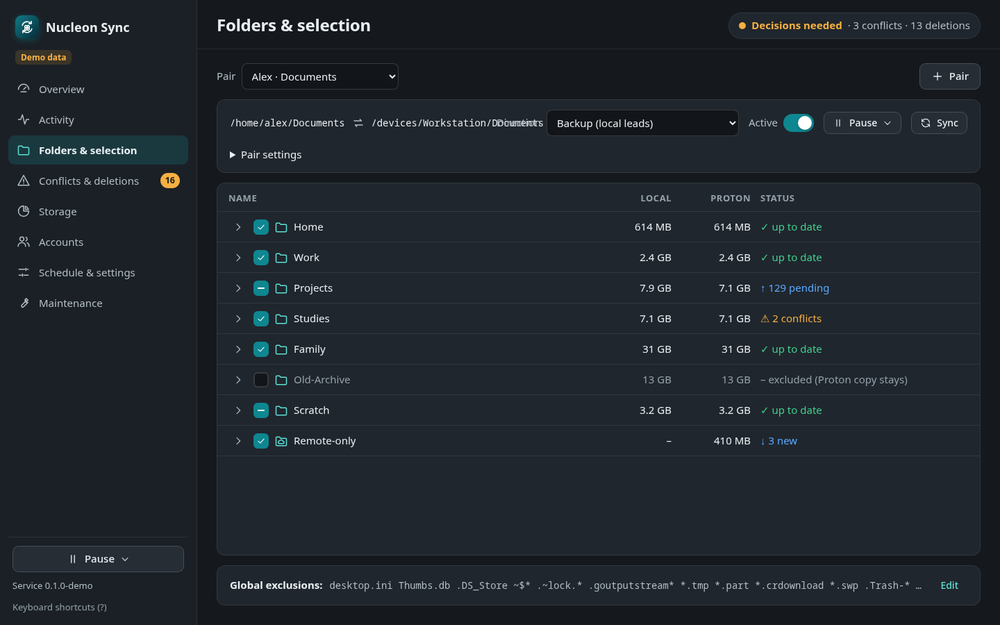
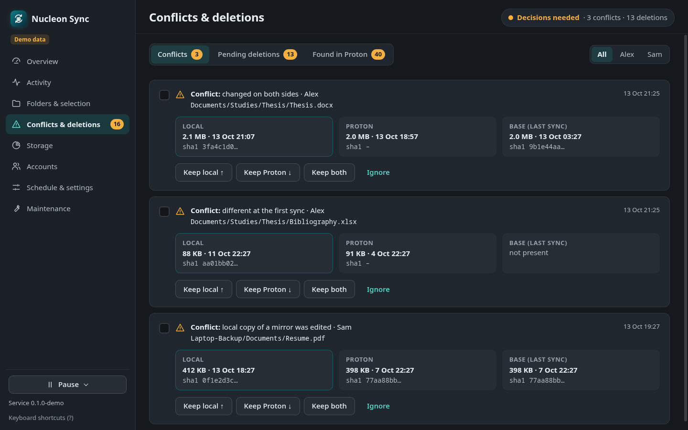
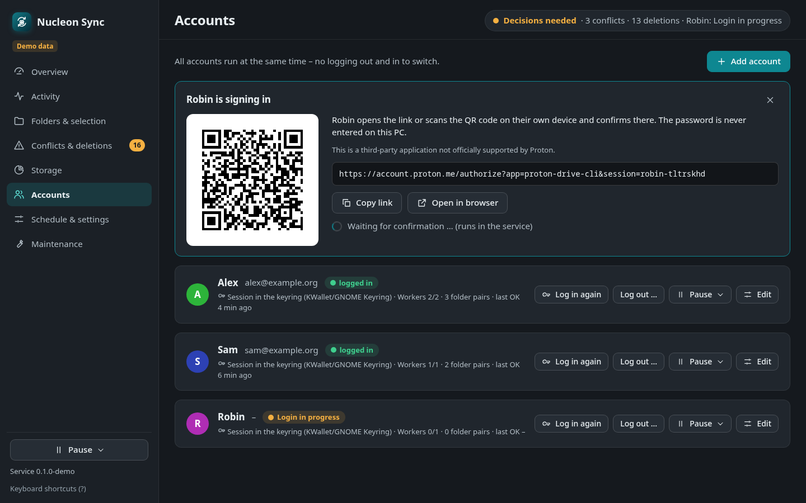

# Nucleon Sync

Folder sync for **Proton Drive on Linux**, built on the **official `proton-drive` command-line client**: a background
service, a tray dashboard, and a command line for you and your scripts or AI agents. Several Proton accounts at once,
careful with deletions, and gentle on Proton's servers.

> **Disclaimer.** Nucleon Sync is an independent, community-made application. It is **not affiliated with, endorsed
> by or supported by Proton AG**. This is a third-party application not officially supported by Proton. "Proton" and
> "Proton Drive" are trademarks of Proton AG and are used here only to say what this app works with. Please do not
> contact Proton support about problems with Nucleon Sync — open an issue here instead.



| Folders and selection                         | Conflicts and deletions                     | Signing in (link or QR)                          |
| --------------------------------------------- | ------------------------------------------- | ------------------------------------------------ |
|  |  |  |

## What it does

- **Folder pairs** between your computer and Proton Drive, each with a direction:
  - **backup** – your folder is the source; new and changed files are uploaded, files that exist only in Proton come
    down; local deletions wait for your decision;
  - **mirror** – Proton is the source; new files come down, files deleted in Proton go to your local trash;
  - **upload only** – nothing is ever downloaded or deleted;
  - **two-way** – for folders you edit on several devices; a file changed on both sides is kept twice.
- **Nothing disappears silently.** Deletions go to the trash (local freedesktop trash or the Proton trash), local
  deletions in backup pairs wait in a review list, safety brakes stop a run when a folder suddenly looks empty or
  many files vanish at once, and two-way mass deletions are held until you confirm them.
- **Several accounts** at the same time (for example your own and a family member's), each with its own session in
  your keyring, and runs that do not block each other.
- **Adopts what is already in Proton**: files uploaded earlier (for example by Proton's own apps) are recognised by
  content and moved or adopted instead of being uploaded twice.
- **Dashboard** with tray icon: status, transfers with progress and ETA, an activity feed, a folder tree with
  include/exclude, conflicts and pending deletions, storage per account, diagnostics. Keyboard-friendly, English and
  German, light and dark, follows your Omarchy theme.
- **Command line and agents**: `nucleon-sync status|sync|pause|activity|conflicts|… --json` with a documented JSON
  contract and exit codes. Scoped agent tokens let tools like Claude Code or Codex check status and start syncs;
  anything destructive an agent asks for waits for your approval in the dashboard. A ready-made agent skill is in
  [`agent-skill/SKILL.md`](agent-skill/SKILL.md).
- **Status bar** module for Waybar and the Omarchy shell, plus Omarchy menu entries.
- **Notifications**: desktop notifications, optionally a Telegram bot of your own, or any command you like.

## How it works

```
   dashboard (Electron)    nucleon-sync CLI / agents    status bar
            \                      |                     /
             └──── local API (Unix socket, bearer tokens) ┘
                                   |
                     nucleon-syncd (systemd user service)
               state DB (SQLite) · planner · scheduler · executor
                                   |
                official proton-drive CLI (one REPL worker per account)
                    sessions in your keyring via a small pass shim
                                   |
                              Proton Drive
```

Nucleon Sync never talks to Proton's API itself: every remote operation goes through Proton's own CLI, unmodified.
Details: [docs/ARCHITECTURE.md](docs/ARCHITECTURE.md), sync semantics: [docs/SYNC-RULES.md](docs/SYNC-RULES.md).

## Install

### Arch Linux and derivatives (AUR)

Two packages; both depend on the official CLI from the AUR (`proton-drive-cli-bin`, or `proton-drive-cli` built from
source):

```bash
yay -S nucleon-sync-bin   # prebuilt app in /opt/nucleon-sync
# or
yay -S nucleon-sync       # built from source, runs on the system electron44
```

Then start **Nucleon Sync** from your application menu (or run `nucleon-sync-gui`). The setup wizard does the rest.

### AppImage (any distribution)

Download `Nucleon-Sync-<version>-x86_64.AppImage` and `SHA256SUMS` from the
[releases](https://github.com/flofischerpfuhl-stack/nucleon-sync/releases), check it, and run it:

```bash
sha256sum -c --ignore-missing SHA256SUMS
chmod +x Nucleon-Sync-*-x86_64.AppImage
./Nucleon-Sync-*-x86_64.AppImage
```

AppImages need FUSE 2 (`fuse2` / `libfuse2`); without it, add `--appimage-extract-and-run`. The wizard copies the
AppImage to `~/.local/share/nucleon-sync` so the background service has a stable path.

### From source

Node ≥ 26 and pnpm 11:

```bash
git clone https://github.com/flofischerpfuhl-stack/nucleon-sync && cd nucleon-sync
pnpm install
scripts/install-user.sh --dry-run   # shows every step
scripts/install-user.sh             # user unit (not enabled), launcher, CLI symlink
```

See [CONTRIBUTING.md](CONTRIBUTING.md) for development.

## Quick start

The first-run wizard walks you through:

1. **System check** – CLI, keyring, systemd, tray.
2. **Official CLI** – uses an installed `proton-drive` (e.g. from the AUR) or downloads it from proton.me. The
   download is checked against the SHA-512 in Proton's release list **and** against hashes pinned in this release
   for the CLI versions Nucleon Sync was tested with. Nucleon Sync never updates the CLI on its own.
3. **Keyring** – your Proton session goes into GNOME Keyring or KWallet (Secret Service); without one, into an
   encrypted file.
4. **Background service** – a systemd user unit and, if you want, the tray icon at login. No root.
5. **Log in** – on Proton's website (link or QR code); Nucleon Sync never sees your password.
6. **Folders** – choose local folders, Proton folders and a direction per pair. Nothing is preselected.
7. **Schedule and notifications** – then the first sync starts.

Afterwards, from a terminal:

```bash
nucleon-sync status                 # accounts, pairs, runs, transfers
nucleon-sync sync --wait            # sync now and wait
nucleon-sync activity --limit 20    # what happened
nucleon-sync conflicts              # what needs a decision
nucleon-sync doctor                 # read-only diagnostics (works without the service)
journalctl --user -u nucleon-sync -f
```

## Agents and automation

Agents use the same CLI with `--json` and an agent token:

- the built-in token may read everything, sync, pause and resume;
- named tokens with the scopes `sync`, `manage` and `destructive` are created in Settings → Agents & API (or with
  `nucleon-sync tokens create NAME --scopes … --ui-token`) and used with `--agent NAME`;
- destructive requests by agents (deleting, emptying the trash, changing a pair's direction, …) always wait for your
  approval in the dashboard.

Exit codes: 0 ok, 1 error, 2 usage, 3 service not running, 4 nothing runnable, 5 confirmation required, 6 forbidden or
denied, 7 approval pending. The full contract is in [docs/CLI-JSON.md](docs/CLI-JSON.md); every CLI command, API
route and setting and where it lives in the dashboard is listed in [docs/PARITY.md](docs/PARITY.md).

## Omarchy and Waybar

```bash
nucleon-sync-omarchy install     # bar module in the Omarchy shell + menu entries (needs jq)
nucleon-sync-omarchy uninstall   # removes exactly what it added
nucleon-sync-omarchy install --waybar   # Waybar: copies the module and CSS, prints the two lines to add
```

The dashboard picks up the current Omarchy theme's colours and follows theme switches (Settings → Colours to turn
it off).

## Notifications

- **Desktop notifications** from the dashboard.
- **Telegram bot of your own**: create a bot with @BotFather, then enter its token and your chat id in Settings →
  Notifications. The token is stored in your keyring and never shown again.
- **Any command**: set `"notifyCommand": ["/path/to/script"]` in `~/.config/nucleon-sync/daemon.json`. It runs
  without a shell on every notification, with `NUCLEON_SYNC_EVENT` (`notice`, `digest`, `test`),
  `NUCLEON_SYNC_SEVERITY`, `NUCLEON_SYNC_KEY`, `NUCLEON_SYNC_TITLE`, `NUCLEON_SYNC_BODY`, `NUCLEON_SYNC_TEXT`,
  `NUCLEON_SYNC_ACCOUNT_ID` and `NUCLEON_SYNC_ACCOUNT_NAME` in its environment — use it for mail, ntfy, Matrix or
  your own assistant. It can only be set in that file, not over the API.

Problems are sent right away (once per kind within the configured interval); conflicts, pending deletions and files
found in Proton come in one daily summary.

## Limits of the official CLI (and what Nucleon Sync does about them)

- **No change feed.** The CLI cannot tell what changed in Proton, so every run lists your Proton folders. Proton asks
  third-party apps not to poll often or traverse whole drives frequently, so the defaults are gentle: a quick run
  every **6 hours** and a full comparison every **4 weeks**, plus syncs you start yourself. Local changes are picked
  up on the next run. Lower intervals are possible but please stay considerate.
- **Rate limits.** Proton throttles heavy use. Nucleon Sync runs at most 3 CLI workers in total, backs off on
  throttling and shows it in the dashboard.
- **No quota API.** Storage figures come from listing your Drive; the shared storage size of a plan can be entered
  by hand.
- **Version coupling.** Nucleon Sync parses the CLI's output. With a CLI version it was not tested with, the daemon
  only reads (no uploads, downloads or deletions) until a tested release of Nucleon Sync is installed.
- **Quirks handled in one place**: upload paths are glob patterns in the CLI (files with `[`, `]`, `*`, `?` or braces
  in their names are uploaded through a temporary link), names starting with `-`, thumbnail generation failing for
  some formats, Proton Docs that cannot be downloaded as files.
- **Telemetry.** The official CLI binary is Proton's; it contains Proton's own crash reporting. Nucleon Sync itself
  sends nothing anywhere except to the notification channels you configure.

## Configuration and files

| Path                                     | Content                                                       |
| ---------------------------------------- | ------------------------------------------------------------- |
| `~/.config/nucleon-sync/`                | `daemon.json` (optional), API tokens (0600), agent tokens     |
| `~/.local/state/nucleon-sync/`           | `state.sqlite`, per-account CLI worker dirs, download staging |
| `$XDG_RUNTIME_DIR/nucleon-sync/api.sock` | local API (0600)                                              |
| keyring (Secret Service)                 | one Proton session per account, the Telegram bot token        |

Optional `daemon.json` keys (read when the service starts):

| Key              | Meaning                                                                                                                                                               |
| ---------------- | --------------------------------------------------------------------------------------------------------------------------------------------------------------------- |
| `cliPath`        | `proton-drive` binary (default: `~/.local/bin/proton-drive`, else the one on `PATH`)                                                                                  |
| `stagingDir`     | where downloads are assembled (default `~/.local/state/nucleon-sync/staging`); on the same filesystem as your folders, files are renamed into place instead of copied |
| `secretBackend`  | `libsecret` (default) or `encfile`                                                                                                                                    |
| `requiredMounts` | paths that must be mount points, e.g. `["/mnt/data"]` (diagnostics fail otherwise)                                                                                    |
| `protectedPaths` | local paths that may never be synced, e.g. a backup disk                                                                                                              |
| `notifyCommand`  | command run on notifications (see above)                                                                                                                              |
| `tcpPort`        | also listen on `127.0.0.1:<port>` (off by default)                                                                                                                    |
| `dailyHour`      | hour of the daily storage measurement and summary (default 9)                                                                                                         |
| `cliTimeouts`    | per-command CLI timeouts                                                                                                                                              |

Everything else (schedule, transfers, notifications, exclusions) is in Settings and `nucleon-sync settings`.

## Security

- The service listens on a Unix socket only you can open; clients authenticate with random tokens stored with mode 0600. An optional TCP port binds to 127.0.0.1 only and rejects browser requests.
- Proton sessions stay in your keyring. To work around a race in the CLI's token refresh, the bundled `pass` shim
  ignores the CLI's automatic sign-out; signing out from the dashboard really removes the session.
- The dashboard runs with Electron's sandbox and context isolation, a strict content security policy and an IPC
  allow-list.
- No auto-updater. Release files come with `SHA256SUMS`.

Programs running as your user can read your tokens and keyring items — the same is true for the official CLI.
Details and how to report a vulnerability: [SECURITY.md](SECURITY.md).

## License

Nucleon Sync is free software: GPL-3.0-or-later (see [LICENSE](LICENSE)). It is a non-commercial project made to help
people who want Proton Drive on Linux. The official `proton-drive` CLI is Proton's software under its own licence and
is not distributed with Nucleon Sync.
